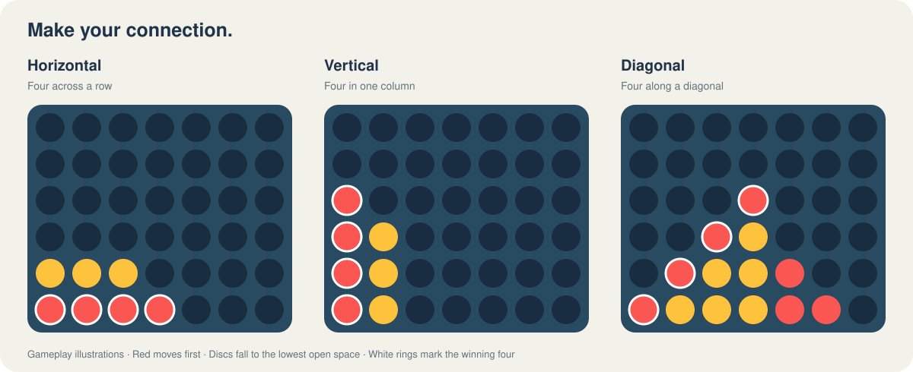

# Connect Four for macOS

A native SwiftUI desktop game for a little friendly rivalry. Play locally with a friend or challenge the computer at three difficulty levels. Runs completely offline, with no external dependencies.

## See how to win



*Gameplay illustrations, not app screenshots. White rings mark the winning four. Both diagonal directions count.*

## Features

- Classic 7-column × 6-row board with gravity and automatic win/draw detection.
- Two-player local games and computer opponents: Easy, Medium, and Hard.
- Animated disc drops, highlighted winning discs, and light/dark appearance.
- Persistent scores and preferences, with separate scoreboards for each game mode.
- Mouse controls and keyboard shortcuts, plus reduced-motion support.
- Background AI searches that are cancelled when you restart or change settings.

## Build and launch

Requires macOS 13 or later and Xcode or Apple’s Command Line Tools. Built and tested on Apple Silicon. No paid developer account is required.

```sh
git clone git@github.com:AshotTadevosyan/connect4.git
cd connect4
bash scripts/build.sh
```

Then double-click **ConnectFour.app** in Finder. You can move the app to Applications; it runs without Terminal or a server. The compiled app is generated locally and is not committed to this repository.

The build script compiles the release executable, generates the application icon, creates the app bundle, and applies a local ad-hoc signature. It does not notarize the app for distribution.

For development, open `Package.swift` in Xcode. Use the build script to package the Finder-launchable app.

## How to play

Red starts every round. Select any column with room to drop your disc into its lowest available position. Connect four horizontally, vertically, or diagonally to win. A full board without a winner is a draw.

| Control | Action |
| --- | --- |
| Click a column / press **1–7** | Drop a disc |
| **New Game** / **⌘N** | Restart the round |
| Game mode selector | Switch between computer and local play; starts a new round |
| Difficulty selector | Change computer strength; starts a new round |
| **Reset scores** | Clear scores for the selected mode |

In computer mode, you play red and the computer plays yellow. Scores and preferences are saved automatically between launches.

## Computer opponents

| Difficulty | Strategy |
| --- | --- |
| Easy | Random legal moves |
| Medium | Takes immediate wins, blocks immediate threats, then evaluates a move and its replies |
| Hard | Seven-ply minimax with alpha-beta pruning, center preference, and evaluation of potential four-disc lines |

## Tests

With full Xcode installed:

```sh
swift test -c release
```

With Command Line Tools alone (without XCTest):

```sh
bash scripts/test.sh
```

Both routes run the same seven test groups covering horizontal/vertical/diagonal wins, gravity, full columns, invalid moves, turn alternation, draws, restart behavior, score persistence, and AI legality, wins, and blocking. The standalone runner passed on the development Mac. Automated UI interaction tests are not included.

## Source layout

```text
Sources/
  ConnectFour/              SwiftUI interface and asynchronous game coordinator
  ConnectFourCore/          Board, game rules, AI, scores, and persistence
Tests/ConnectFourCoreTests/ Shared rule and AI tests
Resources/Info.plist        macOS app metadata
scripts/build.sh           Release build and app packaging
scripts/icon.swift         Native application icon generator
scripts/test.sh            Standalone test runner
docs/images/              README gameplay illustrations
```
